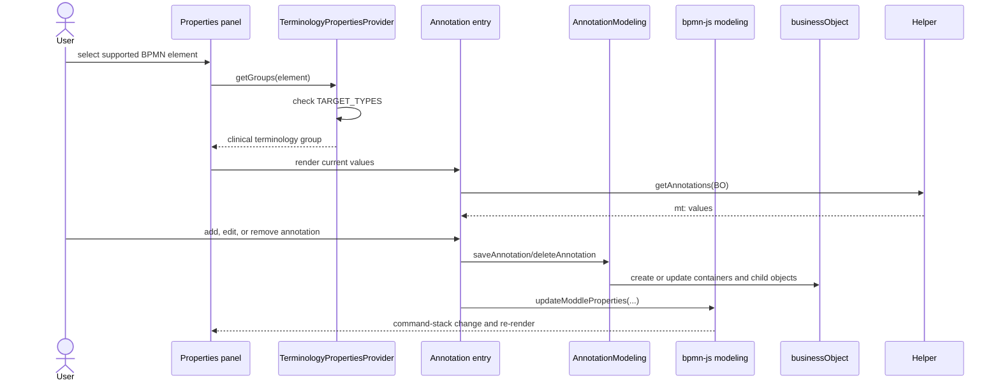
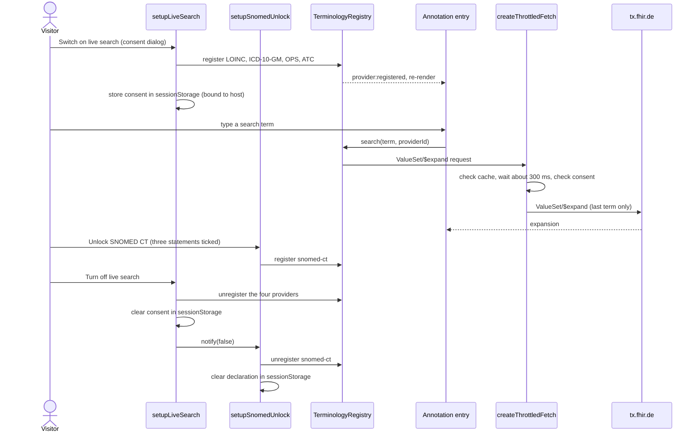

# 6. Runtime View

_Describes important runtime interactions in the host bpmn-js application and
in the conformance tools._

The package has no server or long-running process. Runtime execution occurs
inside a consumer's bpmn-js modeler, while the repository tools execute as
short-lived Node.js processes.

## Scenario 1 — Load an annotated diagram

The host registers the descriptor and imports BPMN XML:

```js
const modeler = new BpmnModeler({
  container: '#canvas',
  additionalModules: [
    createTerminologyPropertiesPanelModule(),
    createDefaultTerminologyModule()
  ],
  moddleExtensions: {
    mt: TerminologyModdleDescriptor
  }
});

await modeler.importXML(annotatedBpmn);
```

`bpmn-moddle` materializes `mt:Annotations`, `mt:Annotation`, and
`mt:Coding` values inside `bpmn:extensionElements`. Without the descriptor,
the host cannot provide typed terminology objects; the conformance roundtrip
tool reports parse warnings for unknown content.

## Scenario 2 — Select and edit an element



`AnnotationModeling` creates `bpmn:ExtensionElements` and `mt:Annotations`
lazily. Created objects receive `$parent` links. bpmn-js therefore owns
undo/redo and serialization rather than the entry component mutating XML
directly.

## Scenario 3 — Render badges and generated comments

The terminology services module includes the diagram module. Badges are
rendered for annotated BPMN elements without adding badge data to XML. When a
user enables **Show terminology as BPMN comments**, the comment visibility
service creates linked `bpmn:TextAnnotation` and `bpmn:Association` elements.
The annotation carries `mt:GeneratedComment` so the service can recognize it;
comment text is regenerated from the ordered `mt:` annotation data when it
changes. The preview has no line-count limit and is capped at 350 diagram units
wide. The complete clinical data remains in `mt:`.

## Scenario 4 — Serialize and check a roundtrip

The demo uses `modeler.saveXML({ format: true })` for its XML preview and
download. The conformance tool performs the same operation without a modeler:

1. Discover `.bpmn` files under `examples/valid/` and `docs/`.
2. Parse each file with `mt` registered.
3. Serialize to XML A.
4. Parse A and serialize again to XML B.
5. Require A and B to be identical.
6. Compare `<mt:...>` element counts to detect dropped extension elements.
7. Report parse warnings; `--strict` promotes warnings to failures.

The command is `npm run check:roundtrip`, and it is part of
`npm run check:conformance` and `npm run verify`.

## Scenario 5 — Search terminology

Integrator code calls the registry:

```js
const result = await terminologyRegistry.search('pneumonia', 'snomed-ct');
const concept = await terminologyRegistry.lookup('169069000', 'snomed-ct');
```

The registry delegates to the selected provider. The default SNOMED provider
is a `FhirProvider` for the server in `serverConfig.fhirBaseUrl` and the edition
in `snomedConfig.edition` (or an explicit `snomedConfig.valueSetUri`), and uses
FHIR `$expand`/`$lookup`; without a server and one of the two, no SNOMED
provider is registered. When an integrator explicitly selects Snowstorm transport,
the default factory instead registers a `SnomedCtProvider`. `StaticProvider`
searches in-memory concepts. Package providers are built from FHIR
`CodeSystem` resources and preserve each resource's canonical URL in returned
concepts.

## Scenario 6 — Discover package-backed CodeSystems

The bundled HL7 preset imports its generated CodeSystem module directly and
does not depend on Vite APIs. The Vite plugin remains an optional build-time
path for additional consumer-selected packages: it finds selected
`CodeSystem` JSON resources, filters them by exact canonical `CodeSystem.url`,
and exposes a virtual module and optional global. The default service factory
groups discovered resources by package, creates one provider per package, and
combines those providers with the built-in defaults. Explicit
`include`/`exclude` settings fail fast when a configured canonical URL does not
exist.

## Scenario 7 — Public demo: optional live search and SNOMED CT unlock

The public demo build names an opt-in server in `VITE_OPT_IN_FHIR_BASE_URL`;
the Pages workflow takes it from the repository variable
`DEMO_OPT_IN_FHIR_BASE_URL`. `describeDemoOptInServer`
(`demo/src/terminology-config.js`) returns `null` when that value is empty or a
local server is configured (`VITE_FHIR_BASE_URL`, or `VITE_SNOWSTORM_BASE_URL`
with `VITE_SNOWSTORM_BRANCH`), and then nothing is offered. After bootstrap, `demo/src/app.js` calls
`setupOptIn` (`demo/src/opt-in.js`), which creates one throttled fetch for the
FHIR providers and a separate one for SNOMED CT and then calls
`setupLiveSearch` (`demo/src/live-search.js`). It offers the live search only
if `demo/index.html` names the server's operator in a
`[data-live-search-operator]` block, which exists for tx.fhir.de alone. Nothing
is sent to the opt-in server until the visitor confirms the separate consent
dialog; accepting the licence notice does not switch it on.



1. `enable()` builds FHIR providers for LOINC, ICD-10-GM, OPS and ATC with
   `createDemoOptInProviders` and registers each one whose ID is not yet in
   the `TerminologyRegistry`. The annotation entry re-renders on
   `provider:registered` and `provider:unregistered`.
2. Consent is stored in `sessionStorage` (`fdh-demo-live-search-consent-v1`,
   bound to the host), and the server notice switches to its opt-in variant.
   Stored consent for the same host re-enables the search on reload without
   storing it again; consent stored for another host is ignored.
3. The annotation entry sends nothing for a term shorter than
   `serverSearchMinLength` (three characters) with a provider that reports
   `sourceType: 'api'` or `remoteSearch: true`. The package panel would also
   wait `serverSearchDebounceMs` (300 ms) after the last keystroke; the demo
   sets it to `0` because its fetch wrapper delays instead. Searches go
   through `createThrottledFetch`. A `ValueSet/$expand` filter
   shorter than three characters is answered locally with an empty
   expansion, and a cached URL is answered from the cache. Every other request
   waits about 300 ms; the properties panel aborts the previous search on each
   keystroke, so only the last one is sent. After the delay, the wrapper checks
   again that the live search (or, for SNOMED CT, the unlock) is still on and
   otherwise sends nothing. Successful, non-redirected responses are cached by
   URL.
4. `disable()` (*Turn off live search*, German *Live-Suche ausschalten*) unregisters the providers it added,
   clears the stored consent, restores the default notice and notifies the
   subscribers. While the live search is on, *Live search details* (*Details
   zur Live-Suche*) reopens the consent information. The dialogs and the banner
   are German or English after `navigator.languages`, with a DE | EN switch
   (`demo/src/i18n.js`); the labels here are the English ones.
5. If the build also sets `VITE_OPT_IN_SNOMED_EDITION` (optionally
   `VITE_OPT_IN_SNOMED_EDITION_VERSION`), `describeDemoOptInSnomed` returns
   the edition, but only for `11000274103` (German National Edition), the
   one edition the self-declaration describes; any other module id is
   refused with a console warning. `setupSnomedUnlock`
   (`demo/src/snomed-unlock.js`) subscribes to the live search. *SNOMED CT…* appears only while the live
   search is on and opens a dialog with three unticked self-declaration
   statements; *Unlock SNOMED CT* stays disabled until all are ticked. The
   unlock registers a SNOMED CT `FhirProvider` from
   `createDemoOptInSnomedProvider` and stores the declaration in
   `sessionStorage` (`fdh-demo-snomed-self-declaration-v1`, bound to host and
   edition). The declaration is not verified. *Lock SNOMED CT*, or the live
   search being switched off, unregisters the provider and clears the
   declaration. The Pages workflows set no `VITE_OPT_IN_SNOMED_EDITION`.

A local preview uses the same `createThrottledFetch` for a server from
`demo/.env.local`, with the delay and the cache but without a minimum term
length of its own; the panel's three-character minimum still applies.

Outside the demo, the properties panel of the package throttles server
searches itself: for a provider with `sourceType: 'api'` or
`remoteSearch: true` it sends a search only from `serverSearchMinLength`
characters on (default 3) and `serverSearchDebounceMs` after the last
keystroke (default 300 ms), aborts the running request on each keystroke and
drops results of an older term. Bundled and other local providers search at
once.

## Error and edge behavior

- Provider registration rejects duplicate provider IDs.
- Registry lookup of an unknown provider reports the available IDs.
- Adapter failures are propagated to the caller; production retry,
  authentication, and availability policy belong to the host application.
- A missing package CodeSystem can cause a preset to be skipped or discovery
  to report a configuration error.
- The demo catches import/bootstrap failures and logs them; it does not define
  a production error UI.

---

[← Architecture index](../ARCHITECTURE.md) · [Previous](05_building_block_view.md) · [Next →](07_deployment_view.md)
