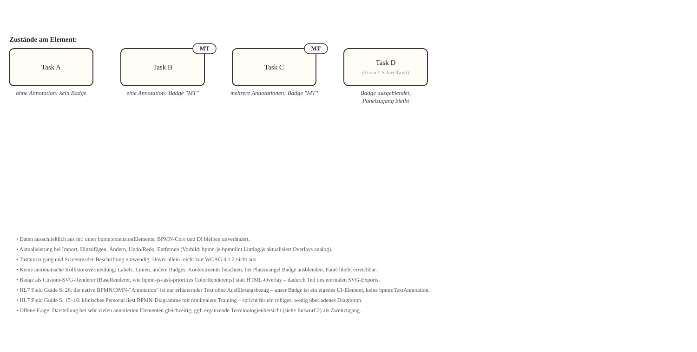
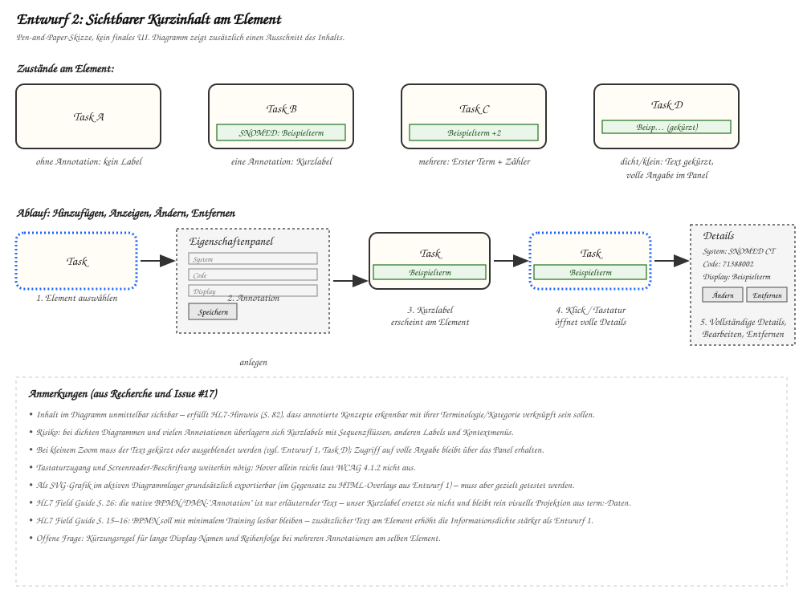

## Gewählte Lösung – BPMN-Kommentar aus Terminologiedaten

Die Extension erzeugt für annotierte Elemente echte BPMN-`TextAnnotation`s und
verbindet sie über `bpmn:Association`. Der Kommentartext wird als
`text/plain`-Snapshot in `bpmn:text` gespeichert, damit auch Editoren ohne die
Extension ihn als normalen BPMN-Kommentar anzeigen können. Die `mt:`-Daten
bleiben die Quelle der Terminologie; ein `mt:GeneratedComment`-Marker
identifiziert automatisch erzeugte Kommentare zur Synchronisierung. Ein rundes
`MT`-Badge am Kommentarblock kennzeichnet sie zusätzlich als
Extension-Darstellung.

Der globale Schalter im Eigenschaftenpanel erzeugt bzw. entfernt diese
TextAnnotations. Beim erneuten Einschalten werden sie aus dem aktuellen
`mt:`-Stand neu aufgebaut. Änderungen an Terminologiedaten aktualisieren die
zugehörigen Kommentar-Snapshots. Bei eingeschaltetem Schalter sind
BPMN-TextAnnotations, Kommentartext und Associations im BPMN-XML enthalten; der
Kommentar ist auch im SVG-Export enthalten. Der Properties-Panel-Eintrag ist
bei allen Elementen sichtbar; nur konfigurierte Zieltypen erhalten zusätzlich
den Annotation-Editor.

Die Positionierung prüft Formen, Beschriftungen, generierte Kommentare und
Verbindungen im Diagramm. Beschriftungen blockieren Kommentarflächen, aber
nicht den direkten Association-Pfad vom Ursprungselement. Die Suche prüft zuerst
nahe freie Positionen rechts, unten, oben und links vom annotierten Element. Wenn der lokale Bereich belegt ist, öffnet die
diagram-js-Space-Tool-Logik an der bevorzugten Seite Platz und verschiebt
betroffene Elemente bzw. vergrößert übergreifende Container. Diese
Layoutänderung bleibt bestehen, auch wenn der globale Schalter die Kommentare
wieder entfernt.

## Alternative – Kurzinhalt am Element

Kurztext (`Beispielterm`, bei mehreren `+2`) direkt am Element; Details im Panel.

- ➕ Inhalt sofort im Diagramm sichtbar, SVG-exportierbar
- ➖ höhere Infodichte, Überlappungsrisiko, braucht Kürzungsregeln

## Weiterhin geltende Anforderungen

- Klinische Terminologiedaten bleiben strukturiert in `mt:` unter
  `bpmn:extensionElements`; `bpmn:text` enthält nur die lesbare Kommentar-Kopie
- Update bei Import, Ändern, Undo/Redo, Entfernen
- Tastaturzugang + Name/Rolle/Zustand programmatisch bestimmbar (Hover reicht laut
  [WCAG 4.1.2](https://www.w3.org/WAI/WCAG22/Understanding/name-role-value.html) nicht)
- BPMN-TextAnnotations sind BPMN-Artefakte; die medizinische Semantik bleibt in `mt:`
- Export-/SVG-Verhalten überprüfen

## HL7 Field Guide (Fassung 2025-10-31)

| Seite | Aussage | Übertragung |
|---|---|---|
| 15–16 | BPMN ist für klinisches Personal mit minimalem Training lesbar | spricht für ruhiges Diagramm (→ Entwurf 1) |
| 26 | native BPMN-„Annotation“ ist nur erläuternder Text, ohne Ausführungsbezug | Semantik bleibt in `mt:`, Indikator ist eigenes UI-Element |
| 82 | Konzepte sollen mit Standardvokabularen verknüpft werden | Terminologiesystem/Konzeptart erkennbar mitanzeigen |
| 93–94 | „Used Vocabularies“ ist eigenes Metadatenfeld | stützt separate Anzeige des Terminologiesystems |

## Weitere Quellen

- Iglesias et al. (2022), [doi.org/10.2196/29927](https://doi.org/10.2196/29927)
- Annotation of Health Care Pathways (2021), [doi.org/10.3389/fdgth.2021.688218](https://doi.org/10.3389/fdgth.2021.688218)
- WCAG 2.2: [Keyboard](https://www.w3.org/WAI/WCAG22/Understanding/keyboard.html), [Name/Role/Value](https://www.w3.org/WAI/WCAG22/Understanding/name-role-value.html), [Use of Color](https://www.w3.org/WAI/WCAG22/Understanding/use-of-color.html)
- [diagram-js Overlays.js](https://github.com/bpmn-io/diagram-js/blob/main/lib/features/overlays/Overlays.js), [bpmn-js BaseViewer.js](https://github.com/bpmn-io/bpmn-js/blob/develop/lib/BaseViewer.js)